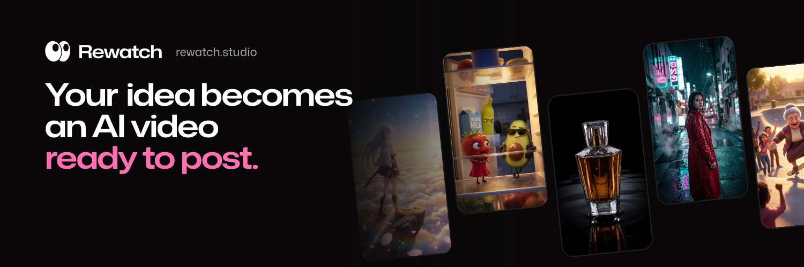

# Rewatch

**[Rewatch](https://rewatch.studio) is an AI video generator that turns a written idea, an image or a TikTok link into a finished vertical story video (9:16)** for TikTok, Reels, Shorts and Facebook.

It writes the script, designs recurring characters, then generates the images, the voices, the animation and the edit with captions. You approve the story and the first scene before the rest is produced.

## What you can make

| Format | Start here |
| --- | --- |
| Story videos with a recurring cast | [AI story video generator](https://rewatch.studio/tools/ai-story-video-generator) |
| Faceless channels and series | [Faceless video generator](https://rewatch.studio/tools/faceless-video-generator) |
| Short dramas, episode after episode | [AI short drama generator](https://rewatch.studio/tools/ai-short-drama-generator) |
| Cartoon and anime shorts | [AI cartoon video generator](https://rewatch.studio/tools/ai-cartoon-video-generator) |
| UGC style ads from a product photo | [UGC ad generator](https://rewatch.studio/tools/ugc-ad-generator) |
| Two host podcast videos, no studio | [AI podcast video generator](https://rewatch.studio/tools/ai-podcast-video-generator) |
| Talking avatars | [AI avatar video generator](https://rewatch.studio/tools/ai-avatar-video-generator) |
| A viral video remade in another style | [Clone a video with AI](https://rewatch.studio/tools/clone-video-with-ai) |
| Brainrot clips | [Text to brainrot](https://rewatch.studio/tools/text-to-brainrot) |

All formats are listed on the [tools page](https://rewatch.studio/tools).

## How it works

1. **Describe the video**: one sentence, a script, a product photo or a TikTok link.
2. **Review before anything is generated**: the script, the characters and the shot list.
3. **Approve one scene, then finish**: the rest is animated, voiced, captioned and edited in 9:16.

Series keep the same cast and universe from one episode to the next. Visual styles include cinematic, anime, cartoon, 3D, comic, pixel art and fruit characters.

## Good to know

- Voices and captions in English, French, Spanish, German, Portuguese and Italian.
- Generation uses credits, from a subscription or a one-off pack: see [pricing](https://rewatch.studio/pricing). There is no unlimited free plan.
- Rewatch does not post to TikTok for you and does not promise views, followers or earnings.

## Compare

How Rewatch differs from tools you may already use: [Opus Clip](https://rewatch.studio/alternatives/opus-clip), [Recast Studio](https://rewatch.studio/alternatives/recast-studio), [SubMagic](https://rewatch.studio/alternatives/submagic), [Revid AI](https://rewatch.studio/alternatives/revid-ai), [Crayo](https://rewatch.studio/alternatives/crayo), [InVideo](https://rewatch.studio/alternatives/invideo), and [more](https://rewatch.studio/alternatives).

## Also from us

[FruitStory](https://fruitstory.ai): talking fruit dramas, scripts and characters for the fruit video trend.

## Links

[Website](https://rewatch.studio) · [Blog](https://rewatch.studio/blog) · [Français](https://rewatch.studio/fr) · [Español](https://rewatch.studio/es) · [Deutsch](https://rewatch.studio/de) · [Português](https://rewatch.studio/pt) · [Italiano](https://rewatch.studio/it)

[TikTok](https://www.tiktok.com/@rewatch_studio) · [Instagram](https://www.instagram.com/rewatch_studio/) · [X](https://x.com/RewatchStudio) · [Product Hunt](https://www.producthunt.com/products/rewatch-studio)
